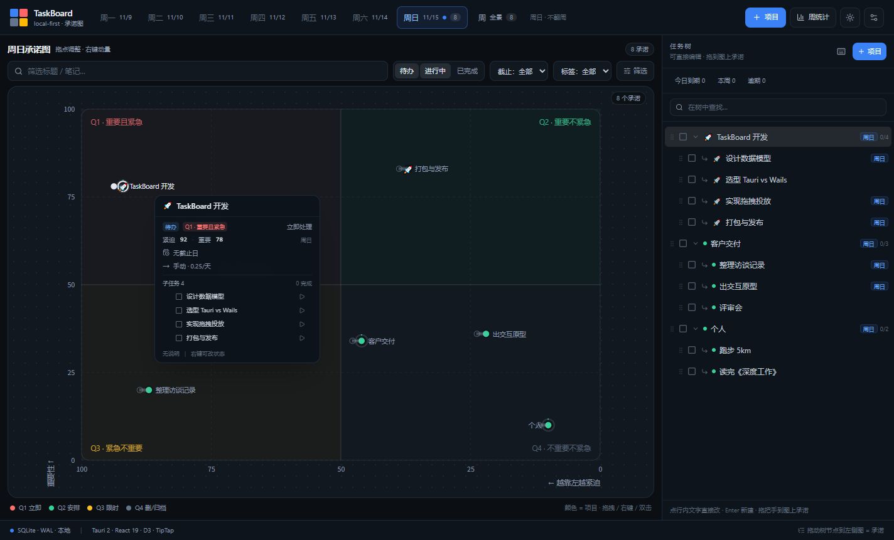
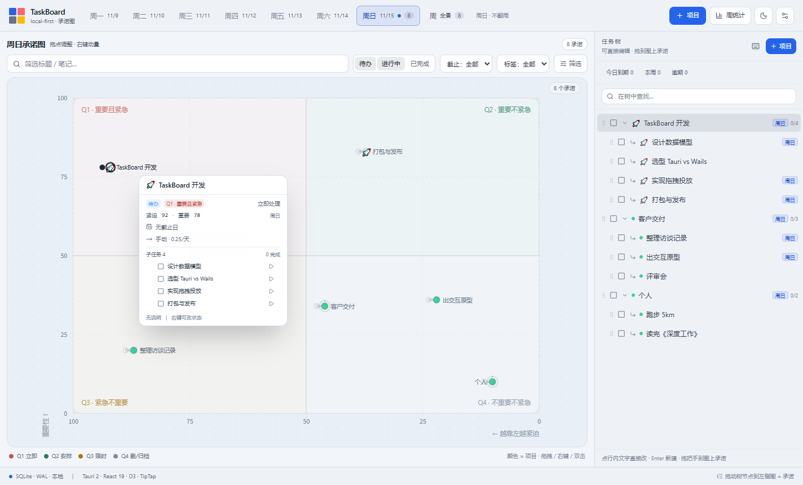

# TaskBoard

**English** · [简体中文](README.md)

A local-first “8 commitment charts” board: break work into a tree, then drag the nodes you are committing to onto 周一…周日 / the week chart, using position to express importance × urgency.



Light theme (toggle in the header):



## Download

Windows x64 (Win10/11, WebView2 required):

- **Installer**: [TaskBoard_0.1.1_x64-setup.exe](https://github.com/lointain/my-task-board/releases/download/v0.1.1/TaskBoard_0.1.1_x64-setup.exe) (1.95 MB)
- **Portable**: [taskboard.exe](https://github.com/lointain/my-task-board/releases/download/v0.1.1/taskboard.exe) (4.63 MB)
- All versions: [Releases](https://github.com/lointain/my-task-board/releases)

## What it does

- **Task tree**: projects / tasks / subtasks, cascading checkboxes, drag to reorder, right-click to decompose.
- **8 boards**: Mon…Sun plus a week board that aggregates the seven days; single-row week strip, no week paging.
- **End-of-day rollover**: unfinished nodes that were not moved or removed by hand roll over to the next day (Sunday → Monday).
- **Momentum**: with a due date, x moves toward 100; without one it drifts right at the default speed (0.25 pt/day); editable from the right-click menu.
- **Due-date inheritance**: a task without its own due date inherits the nearest ancestor's; the detail view shows the source.
- **Detail**: title, status, tag groups, due date + optional TipTap notes (task lists, image URLs).
- **Filters**: text / status / tags / due date, per board.
- **Weekly stats**: completed this week and overdue list.
- **Settings**: tag groups, default momentum, color-by (project / tag group), UI language, back up now.
- **i18n**: Simplified Chinese, Traditional Chinese, English and Japanese; switching is instant.
- **Data**: single SQLite file with WAL at `%APPDATA%\com.yao.taskboard\data.db`.

## Chart details

- The point itself is two layers: the dot (or emoji) plus a progress ring for nodes that have children.
- **Selected panel**: click a point and the tooltip becomes a persistent, interactive panel listing its subtasks; tick them done or start them right there. Children can be shown as direct children, breadcrumb + list, or the full subtree.
- **Momentum vector**: a line with one tick per day and a 7-day ghost; select a point and drag the endpoint to change the vector (switches to manual).
- **Overdue tail**: no extra ring — a red tail pointing the other way encodes how many days late it is.
- **Emoji**: settable per node with inheritance; a node with an icon drops its colored dot.
- Clicking empty space deselects; dragging a point requires selecting it first.

## Tech stack

- React 19 + TypeScript + Vite
- Zustand / Tailwind CSS v4
- D3 (scale / axis / selection / drag)
- TipTap 3
- Tauri 2 + Rust + `rusqlite` (bundled)
- Biome + Vitest

## Development

Rust toolchain path (already added to the user PATH):

```powershell
$env:PATH = "$env:USERPROFILE\.rustup\toolchains\stable-x86_64-pc-windows-msvc\bin;$env:PATH"
```

Install and run:

```powershell
pnpm install
pnpm tauri dev
```

Front-end only (no SQLite in the browser, the backend will report as unavailable):

```powershell
pnpm dev
```

Checks and build:

```powershell
pnpm exec tsc --noEmit
pnpm build
pnpm test
cargo test --manifest-path src-tauri/Cargo.toml
pnpm tauri build
```

Installers land in `src-tauri/target/release/bundle/`. NSIS, without bundling the WebView2 runtime.

Measured size: installer **1.95 MB**, `taskboard.exe` **4.63 MB**.

### Icons

App icons and the web favicon are generated by one script; design constants live in `scripts/generate-icons.py`:

```powershell
python scripts/generate-icons.py
```

## Keyboard and dragging

| Action | How |
|---|---|
| Edit the tree (right panel) | Every row is an input: click the text to edit · `Enter` insert after (child for a top-level project) · `Tab`/`Shift+Tab` indent · `Alt+↑/↓` move · `↑/↓` select · `Alt+←/→` collapse · empty + `Backspace` deletes the row |
| Drag handle | Onto a chart or day tab = commit; onto a row = reorder / re-parent |
| Select a point | Click it; drag only works once selected. Click empty space to deselect |
| Details / notes | Double-click a point or a row; the notes area is always there and stays empty when unused; attributes are collapsed by default |
| Done | Checkbox on the row (cascades). The point is hidden but its coordinates are kept, so unchecking brings it back in place |
| Status | Right-click → Start / Pause |

## Docs

Design documents live in `docs/20261114-01-任务面板/` (Chinese only): 01 idea, 02 stack choices, 03 requirements, 04 high-level design, 05 development log, 06 online plan, 07 chart enhancements, 08 candidate backlog.

## License

Personal project; use at your own risk.

